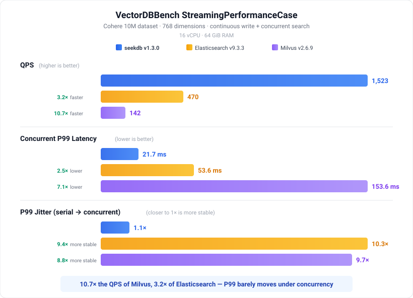
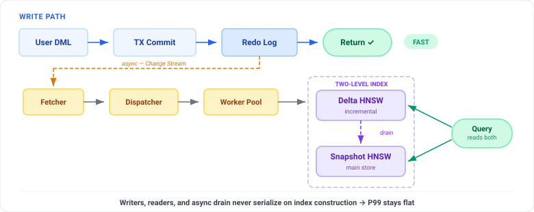

<div align="center">

<picture>
  <source media="(prefers-color-scheme: dark)" srcset="https://mdn.alipayobjects.com/huamei_ytl0i7/afts/img/A*pKqtRILxGioAAAAAQLAAAAgAejCYAQ/original" width="420">
  <source media="(prefers-color-scheme: light)" srcset="https://mdn.alipayobjects.com/huamei_ytl0i7/afts/img/A*6BO4Q6D78GQAAAAAQFAAAAgAejCYAQ/original" width="420">
  
</picture>

# **Write · Search · Fork — AI エージェントのためのステートストア**

<p>
    <a href="https://github.com/oceanbase/seekdb/stargazers">
        
    </a>
    <a href="https://github.com/oceanbase/seekdb/releases">
        
    </a>
    <a href="https://github.com/oceanbase/seekdb/commits">
        
    </a>
    <a href="https://github.com/oceanbase/seekdb/graphs/contributors">
        
    </a>
    <a href="https://github.com/oceanbase/seekdb/issues">
        
    </a>
    <a href="https://github.com/oceanbase/seekdb/blob/HEAD/LICENSE">
        
    </a>
    <a href="https://pepy.tech/projects/pyseekdb">
        
    </a>
    <a href="https://discord.gg/74cF8vbNEs">
        
    </a>
    <a href="https://docs.seekdb.ai/">
        
    </a>
    <a href="https://deepwiki.com/oceanbase/seekdb">
        
    </a>
    <a href="https://www.linkedin.com/company/oceanbase" target="_blank" rel="noopener noreferrer">
        
    </a>
    <a href="https://www.youtube.com/@OceanBaseDB">
        
    </a>
</p>

MySQL 互換 · 組み込み / サーバー両対応 · ベクトル + 全文ハイブリッド検索 · COW サンドボックス

⚡ ストリーミング書き込み + 検索で 1,523 QPS（10× Milvus、3× Elasticsearch）<br>
🌿 FORK/MERGE サンドボックスでエージェントが安全に探索・自由にロールバック<br>
🔍 ベクトル + 全文 + スカラーを 1 本の SQL で完結<br>
🐬 完全な ACID、MySQL プロトコル、LangChain / LlamaIndex / Dify にネイティブ対応

[English](README.md) | [中文版](README_CN.md) | **日本語**

[30 秒で試す](#30-秒で試す) · [クイックスタート](#クイックスタート) · [組み込み SDK](#embedded-sdks) · [なぜ seekdb か](#なぜ-ai-エージェントに-seekdb-なのか) · [エコシステム](#エコシステムと統合) · [開発](#開発)

<sub>seekdb が役立つと思ったら、<a href="https://github.com/oceanbase/seekdb/stargazers">star</a> をお願いします — より多くの人にプロジェクトを届けられます。</sub>

---

</div>

## ⚡ パフォーマンス概要

<div align="center">
  
</div>

> 📖 [ローンチブログを読む →](docs/blog/launch_blog_jp.md) · 🔁 [ベンチマークを再現する →](https://github.com/oceanbase/vdb-streambench)

---

<a id="30-秒で試す"></a>

## ⏱️ 30 秒で試す

<div align="center">
  
</div>

```bash
pip install -U pyseekdb   # pyseekdb は seekdb の Python SDK です
```

> 📋 [demo.py ソースを見る →](images/demo.py)

この Python デモでは、サーバーの手動デプロイ、スキーマ定義、エンベディング設定は不要です。[Python、JavaScript、Go でローカルデータベースを実行 →](#embedded-sdks)

---

<a id="なぜ-ai-エージェントに-seekdb-なのか"></a>

## ✨ なぜ AI エージェントに seekdb なのか？

### 🔥 ストリーミング書き込み + 並行検索、P99 スパイクなし

エージェントのワークロードは「絶え間ない書き込み + ミリ秒単位の読み取り」が本質です。seekdb の**非同期インデックスパイプライン（Change Stream）** が DML とインデックス構築を分離し、**2 レベル HNSW**（インクリメンタル + スナップショット）によって、書き込み直後のベクトルが即座に検索可能になります。

<div align="center">
  
</div>

書き込みパスはコミット後、インデックス構築を*待たずに*即座にリターンします。Change Stream パイプラインが redo ログを非同期で消費し、デルタ HNSW を更新。クエリはデルタインデックスとスナップショットインデックスの両方にきめ細かい読み取りロックでアクセスします — **これが高並行性でも P99 が安定し続ける理由です。**

> **実測結果：1,523 QPS、並行 P99 はわずか 21.7 ms — Milvus の 10.7 倍の QPS を達成。並行数上昇時の P99 ジッターは 1.1 倍に留まります（同一ワークロードで ES / Milvus は約 10 倍）。**

<sub>ソース: [`src/observer/change_stream/`](src/observer/change_stream/) · [`src/observer/vector_index/`](src/observer/vector_index/)</sub>

### 🌿 コピーオンライトサンドボックスでエージェントが自由に探索

`FORK DATABASE` でデータベース全体を数秒でスナップショット — データコピーはゼロ。エージェントはサンドボックス内で自由に実験（書き込み、クエリ、テーブル破壊すら可能）し、`MERGE TABLE` で成果をメインラインに反映するか、`DROP DATABASE` で丸ごと破棄。アプリケーション層の保存/復元ではなく、カーネルレベルの COW で実現しています。

```sql
-- 数秒でスナップショット、データコピーなし
FORK DATABASE agent_state TO agent_sandbox_42;

-- エージェントがサンドボックスで自由に読み書き...
USE agent_sandbox_42;
INSERT INTO memory (session_id, embedding, content) VALUES (...);

-- 成果をメインラインに反映（戦略：FAIL / THEIRS / OURS）
MERGE TABLE agent_sandbox_42.memory INTO agent_state.memory STRATEGY THEIRS;
-- ...または破棄：
DROP DATABASE agent_sandbox_42;
```

<sub>ソース: [`tools/deploy/mysql_test/test_suite/fork_table/`](tools/deploy/mysql_test/test_suite/fork_table/)</sub>

### 🔍 1 つの SQL でハイブリッド検索

ベクトル + 全文 + スカラーフィルターを単一の実行プランに統合。クライアント側での N+1 マージも、結果を貼り合わせるグルーコードも一切不要です。

```sql
SELECT id, title, l2_distance(emb, '[0.12,0.34,...]') AS dist
FROM docs
WHERE MATCH(content) AGAINST('quarterly report')
  AND author_id = 42
  AND created_at > '2026-01-01'
ORDER BY dist APPROXIMATE LIMIT 10;
```

### 🐬 MySQL 互換、ACID、組み込み可能

実績ある OceanBase SQL エンジン上に構築。組み込みライブラリ、単一ノードサーバー、または OceanBase 分散クラスターとして動作します。完全な ACID、リアルタイム書き込み、MySQL エコシステムをそのまま活用できます。

---

<a id="クイックスタート"></a>

## 🎬 クイックスタート

<a id="embedded-sdks"></a>

### 組み込みでの利用

データベースサービスを手動でデプロイせずに、Python、Node.js、Go からローカルの seekdb を利用できます。データは指定したローカルディレクトリに保存され、再度開いても引き続き利用できます。

<details open>
<summary><b>🐍 Python</b></summary>

[pylibseekdb](https://pypi.org/project/pylibseekdb/) でローカルの seekdb を起動し、PyMySQL で SQL を実行します。Python 3.11 以降が必要です。

```bash
python3 -m pip install -U pylibseekdb pymysql
```

以下の例を `example.py` として保存します。`connection_options()` で接続引数を取得し、PyMySQL に渡します。コンテキストマネージャーにより、カーソルと SQL 接続を閉じてからランタイムハンドルを解放します：

```python
from contextlib import closing

import pylibseekdb
import pymysql

with closing(pylibseekdb.open("./seekdb.db")) as db:
    options = db.connection_options()
    with pymysql.connect(
        database="test",
        autocommit=True,
        cursorclass=pymysql.cursors.DictCursor,
        **options,
    ) as connection:
        with connection.cursor() as cursor:
            cursor.execute("SELECT 1 AS value")
            print(cursor.fetchall())
```

実行すると `[{'value': 1}]` が出力されます：

```bash
python3 example.py
```

[詳しい使い方](https://github.com/oceanbase/seekdb-bindings/blob/main/python/README.md) · [対応プラットフォームと環境要件](https://pypi.org/project/pylibseekdb/#requirements)

テキストのエンベディングやハイブリッド検索を備えた高水準の Collection API が必要な場合は、[pyseekdb](https://github.com/oceanbase/pyseekdb) を参照してください。

</details>

<details open>
<summary><b>🟨 JavaScript / TypeScript (Node.js)</b></summary>

[@oceanbase/seekdb-node](https://www.npmjs.com/package/@oceanbase/seekdb-node) でローカルの seekdb を起動し、`mysql2` で SQL を実行します。Node.js 22 以降が必要で、JavaScript と TypeScript の両方に対応しています。

```bash
npm install @oceanbase/seekdb-node mysql2
```

対応するネイティブランタイムが自動インストールされるよう、npm の optional dependencies を有効にしてください。このバインディングは独立したローカル seekdb プロセスを管理します。ランタイムハンドルを解放する前に SQL 接続を閉じてください。

以下の例を `example.mjs` として保存します（ES modules を使用し、TypeScript の型宣言も付属しています）：

```javascript
import { seekdb } from "@oceanbase/seekdb-node";
import mysql from "mysql2/promise";

const db = await seekdb.open("./seekdb.db");
let connection;
try {
  const endpoint = db.connectionOptions();
  const location = endpoint.transport === "tcp"
    ? { host: endpoint.host, port: endpoint.port }
    : { socketPath: endpoint.transport === "unix_socket"
        ? endpoint.unixSocket : endpoint.namedPipe };
  connection = await mysql.createConnection({
    ...location,
    user: endpoint.user,
    password: "",
    database: "test",
  });
  const [rows] = await connection.query("SELECT 1 AS value");
  console.log(rows);
} finally {
  try {
    if (connection) await connection.end();
  } finally {
    db.close();
  }
}
```

実行すると `[ { value: 1 } ]` が出力されます：

```bash
node example.mjs
```

[詳しい使い方と対応プラットフォーム](https://www.npmjs.com/package/@oceanbase/seekdb-node)

高水準の JavaScript Collection API が必要な場合は、[seekdb-js](https://github.com/oceanbase/seekdb-js) を参照してください。

</details>

<details open>
<summary><b>🐹 Go</b></summary>

[seekdb-go](https://github.com/oceanbase/seekdb-go) でローカルの seekdb を起動し、`go-sql-driver/mysql` で SQL を実行します。この例には Go 1.24 以降、`CGO_ENABLED=1`、C コンパイラーが必要です。

```bash
mkdir seekdb-go-example
cd seekdb-go-example
go mod init example.com/seekdb-demo
```

以下の例を `main.go` として保存します。`ConnectionOptions` が返す接続先を使用し、ランタイムハンドルを解放する前に SQL 接続を閉じます：

```go
package main

import (
	"database/sql"
	"fmt"
	"log"
	"net"

	"github.com/go-sql-driver/mysql"
	seekdb "github.com/oceanbase/seekdb-go"
)

func main() {
	if err := run(); err != nil {
		log.Fatal(err)
	}
}

func run() error {
	db, err := seekdb.Open("./seekdb.db")
	if err != nil {
		return err
	}
	defer db.Close()

	endpoint, err := db.ConnectionOptions()
	if err != nil {
		return err
	}
	cfg := mysql.NewConfig()
	cfg.User, cfg.DBName = endpoint.User, "test"
	switch endpoint.Transport {
	case "unix_socket":
		cfg.Net, cfg.Addr = "unix", endpoint.UnixSocket
	case "tcp":
		cfg.Net, cfg.Addr = "tcp", net.JoinHostPort(endpoint.Host, fmt.Sprint(endpoint.Port))
	default:
		return fmt.Errorf("unsupported transport %q", endpoint.Transport)
	}
	connection, err := sql.Open("mysql", cfg.FormatDSN())
	if err != nil {
		return err
	}
	defer connection.Close()

	var value int
	if err := connection.QueryRow("SELECT 1 AS value").Scan(&value); err != nil {
		return err
	}
	fmt.Println(value)
	return nil
}
```

実行時に Go が依存関係を解決し、現在のプラットフォーム用のネイティブバンドルを取得します。結果は `1` です：

```bash
go run -mod=mod .
```

seekdb-go に対する通常の `go get` や `go mod tidy` は、全対応プラットフォームのバンドルも取得することがあります。

[詳しい使い方](https://github.com/oceanbase/seekdb-go#install) · [対応プラットフォームと環境要件](https://github.com/oceanbase/seekdb-go/blob/main/docs/support.md)

</details>

これらの例はデータを `./seekdb.db` に保存し、繰り返し実行できます。このパスはデータベースディレクトリです。新しいディレクトリの初期化には、次回以降の起動より時間がかかることがあります。

### サーバーのデプロイ

<details open>
<summary><b>☁️ クラウド（インストール不要）</b></summary>

curl 一発で稼働中のデータベースが手に入ります — サインアップ不要、クレジットカード不要。

```bash
curl -X POST https://d0.seekdb.ai/api/v1/instances
```

7 日間無料。[詳細はこちら →](https://d0.seekdb.ai)

</details>

<details>
<summary><b>🐳 Docker（簡易テスト）</b></summary>

```bash
docker run -d \
  --name seekdb \
  -p 2881:2881 \
  -p 2886:2886 \
  -v ./data:/var/lib/oceanbase \
  oceanbase/seekdb:latest
```
この Docker イメージの詳細は[ドキュメント](https://github.com/oceanbase/docker-images/blob/main/seekdb/README.md)を参照してください。

</details>

<details>
<summary><b>📦 バイナリ（スタンドアロン）</b></summary>

```bash
# Linux（ワンライナーインストール、sudo が必要な場合あり）
curl -fsSL https://obportal.s3.ap-southeast-1.amazonaws.com/download-center/opensource/seekdb/seekdb_install.sh | bash

# macOS（Homebrew）
brew tap oceanbase/seekdb
brew install seekdb
```

DEB/RPM オフラインインストールと設定の詳細は[デプロイメントドキュメント](https://docs.seekdb.ai/seekdb/deploy-by-systemd/)を参照してください。

</details>

<a id="その他の例"></a>

### 📝 その他の例

まずは上の実行可能な [Python、JavaScript、Go の例](#embedded-sdks)を試してください。以下のアプリケーションパターンは、既存のエージェント実装を前提としています。

<details>
<summary><b>🤖 エージェントメモリパターン（継続的書込 + 即時検索）</b></summary>

エージェントの典型的なループ：観察を書き込み、ミリ秒後に関連コンテキストを検索、これを繰り返します。seekdb の非同期インデックスパイプラインが、持続的な並行負荷の下でも読み書き双方の高速性を維持します。

```python
import pyseekdb

client = pyseekdb.Client(path="./agent_state.db")
memory = client.get_or_create_collection(name="episodic")

for step in agent.run():
    # 観察結果を永続化
    memory.upsert(ids=[step.id], documents=[step.observation])

    # 関連コンテキストを検索 — 書き込みの数ミリ秒後に、
    # インクリメンタル HNSW が即座に応答（バックグラウンドリビルド待ち不要）
    relevant = memory.query(query_texts=step.next_query, n_results=5)

    agent.act(relevant)
```

</details>

<details>
<summary><b>🗄️ SQL — スキーマ + ハイブリッド検索</b></summary>

```sql
-- ベクトル列、全文インデックス、HNSW ベクトルインデックスを持つテーブル
CREATE TABLE articles (
  id        INT PRIMARY KEY,
  title     TEXT,
  content   TEXT,
  embedding VECTOR(384),
  FULLTEXT INDEX idx_fts (content) WITH PARSER ik,
  VECTOR   INDEX idx_vec (embedding) WITH (DISTANCE=l2, TYPE=hnsw, LIB=vsag)
) ORGANIZATION = HEAP;

-- ハイブリッド検索：ベクトル類似度 + 全文マッチを 1 つのクエリで
SELECT id, title,
       l2_distance(embedding, '[0.12, 0.34, ...]') AS dist
FROM articles
WHERE MATCH(content) AGAINST('quarterly report')
ORDER BY dist APPROXIMATE
LIMIT 10;
```

Python 開発者は SQLAlchemy や任意の MySQL ドライバーでアクセスできます。

</details>


## 📚 ユースケース

<details open>
<summary><b>🎯 エージェント AI — メモリ、サンドボックス、ステート</b></summary>

エージェントには、絶え間ないメモリ書き込み、ミリ秒レベルの検索、探索のためのブランチング、問題発生時の即時ロールバックに対応できるステートストアが必要です。seekdb はまさにそのために作られました：

- **ストリーミング対応** — 書き込んだ瞬間から検索可能
- **COW サンドボックス** — `FORK DATABASE` で安全に実験、`MERGE` で採用、`DROP` で即ロールバック
- **ハイブリッド検索** — ベクトル + 全文 + リレーショナルを 1 本の SQL で
- **MySQL プロトコル** — LangChain、LlamaIndex、Dify がそのまま動作

パーソナルアシスタント · エンタープライズ自動化 · バーティカルエージェント · エージェントプラットフォーム

</details>

<details>
<summary><b>🧩 その他のユースケース</b></summary>

seekdb のハイブリッド検索 + マルチモデルエンジンは、従来型の AI ワークロードにも最適です：

- **📖 RAG とナレッジ検索** — ベクトル + 全文 + スカラーフィルター、多段階アクセス制御対応。*エンタープライズ QA、カスタマーサポート、業界インサイト、個人ナレッジベース。*
- **🔍 セマンティック検索** — エンベディングベースのテキスト、画像、マルチモーダル検索。*商品検索、テキストから画像、画像から商品。*
- **💻 AI 支援コーディング** — セマンティックコード検索、マルチプロジェクト分離、タイムトラベルクエリ。IDE プラグインやコードエージェント向け。*ローカル IDE、Web IDE、デザインからコードへ。*
- **⬆️ エンタープライズアプリケーションインテリジェンス** — レガシーシステム向けの MySQL 互換 AI レイヤー、行列ハイブリッドストレージ対応。*ドキュメントインテリジェンス、ビジネスインサイト、金融システム。*
- **📱 オンデバイス＆エッジ AI** — リソース制約のあるデバイス向けの組み込み/マイクロサーバーモード。*車載システム、AI 教育、コンパニオンロボット、ヘルスケアデバイス。*

</details>

---

<a id="エコシステムと統合"></a>

## 🌟 エコシステムと統合

<div align="center">

<p>
    <a href="https://github.com/langchain-ai/langchain/pulls?q=is%3Apr+is%3Aclosed+oceanbase">
        
    </a>
    <a href="https://github.com/run-llama/llama_index/pulls?q=is%3Apr+is%3Aclosed+oceanbase">
        
    </a>
    <a href="https://github.com/langgenius/dify/pulls?q=is%3Apr+is%3Aclosed+oceanbase">
        
    </a>
    <a href="https://github.com/langchain-ai/langchain/pulls?q=is%3Apr+is%3Aclosed+oceanbase">
        
    </a>
    <a href="https://github.com/coze-dev/coze-studio/pulls?q=is%3Apr+oceanbase+is%3Aclosed">
        
    </a>
    <a href="https://huggingface.co">
        
    </a>
</p>

<sub>+ Camel-AI · DB-GPT · FastGPT · Firecrawl · Spring-AI-Alibaba · Cloudflare Workers AI · Jina AI · Ragas · Instructor · Baseten — 完全なリストは[ユーザーガイド](https://docs.seekdb.ai/seekdb/seekdb-overview)を参照してください。</sub>

</div>

---

## 🌐 次のステップとコミュニティ

- 📖 **[ドキュメントを読む →](https://docs.seekdb.ai/)** — クイックスタート、API リファレンス、統合ガイド
- 📝 **[ローンチブログ →](docs/blog/launch_blog_jp.md)** — Milvus の 10.7 倍の QPS を実現したアーキテクチャ
- 🐛 **[Issue を開く →](https://github.com/oceanbase/seekdb/issues)** — バグ報告、機能リクエスト
- 🤝 **[コントリビュート →](CONTRIBUTING.md)** — エージェント時代のステートストアを一緒に作ろう

<div align="center">

<p>
    <a href="https://discord.gg/74cF8vbNEs">
        
    </a>
    <a href="https://github.com/oceanbase/seekdb/discussions">
        
    </a>
    <a href="https://ask.oceanbase.com/">
        
    </a>
</p>

</div>

---

<a id="開発"></a>

## 🛠️ 開発

### ソースからビルド

ビルド前に、お使いの OS に必要なツールチェーンと依存関係をインストールしてください。詳細は[ツールチェーンのインストール](docs/developer-guide/en/toolchain.md)を参照してください。

```bash
# リポジトリをクローン
git clone https://github.com/oceanbase/seekdb.git
cd seekdb
./build.py init
./build.py build seekdb
mkdir -p ~/seekdb/bin
cp build/bin/src/observer/seekdb ~/seekdb/bin
cd ~/seekdb
./bin/seekdb
```

この例では作業ディレクトリとして $HOME/seekdb を使用しています。テストには新しい空のディレクトリを使用してください。詳細は[開発者ガイド](docs/developer-guide/en/README.md)を参照してください。

### コントリビュート

コントリビューション大歓迎です！ まずは[コントリビューションガイド](CONTRIBUTING.md)をご覧ください。

<a href="https://github.com/oceanbase/seekdb/graphs/contributors">
  
</a>

---

## 📈 Star の推移

<a href="https://star-history.com/#oceanbase/seekdb&Date">
  
</a>

seekdb が役立つなら、**star で他の人にも届けましょう。** ⭐

---

## 📄 ライセンス

seekdb は [OceanBase](https://en.oceanbase.com/) チームが開発 — Alipay、Taobao、DiDi、Xiaomi などの本番環境で稼働しているデータベースエンジンと同一基盤です。[Apache License, Version 2.0](LICENSE) に基づく完全なオープンソースプロジェクトです。

OB-P:_nTQ0GiQfyNccdr7eBEM2A
