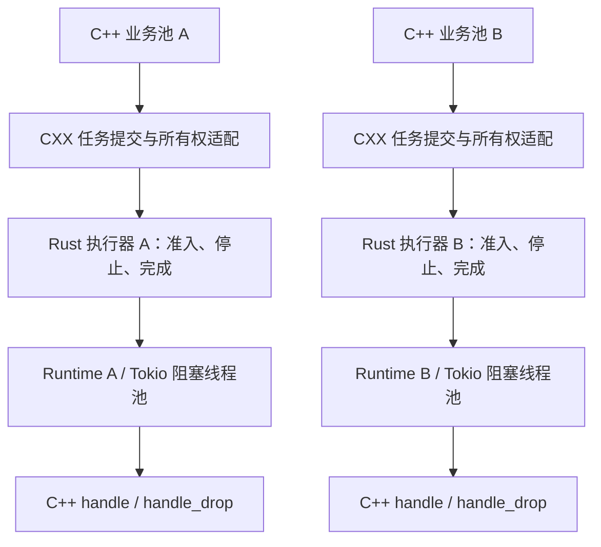

# C++ 弹性线程池接入 Rust/Tokio 设计草案

状态：设计提案，尚未实施。2026-11-14。

本文记录本轮讨论的结论和实现前必须核实的契约。优先级为稳定性、架构鲁棒性、可读性，然后才是性能。本轮仅新增文档，不改 C++ 或 Rust 实现。

## 目标与边界

让适合任务式执行的 C++ 弹性线程池通过现有 CXX 桥接使用 Tokio，复用其线程创建、复用、空闲退出和回收能力。C++ 保留业务任务处理函数，无需改成 async/await。

统一执行器实现，不强制所有业务共享一个线程池。保留业务池的身份、容量限制、停止行为和运行上下文。常驻循环线程、原生 AIO 完成线程不属于本次迁移对象。

不为迁移机械复制所有旧功能；但删除能力之前必须确认调用方不依赖它。当前 I/O 的 Tokio 适配不在本设计中重做。

## 已核实的现状

### C++ 弹性池

主要使用的是 `ObSimpleThreadPoolBase` / `ObSimpleDynamicThreadPool`，包括 `ObSimpleThreadPool` 和 `ObLinkQueueThreadPool`。旧 `ObDynamicThreadPool` 在本次 src 搜索中未发现定义之外的生产调用，不能把两者混称。

现有契约：

- 任务队列有容量限制，满时返回 `OB_EAGAIN`，停止后拒绝提交。
- 正常任务调用 `handle(task)`；停止后的剩余任务走 `handle_drop(task)`。默认实现可以等同 handle，但部分业务覆写了清理行为。
- 支持调整线程上下限。worker 空闲退出后，由全局 `qth_mgr` 周期性回收。
- C++ worker 安装 Worker TLS、线程和内存上下文、run wrapper；Tokio 创建的线程不会自动具有这些环境。

证据入口：

- [线程池接口](../../../src/oblib/lib/thread/ob_simple_thread_pool.h)
- [提交、执行与停止逻辑](../../../src/oblib/lib/thread/ob_simple_thread_pool.ipp)
- [动态池与回收管理](../../../src/oblib/lib/thread/ob_dynamic_thread_pool.cpp)
- [C++ 线程环境](../../../src/oblib/lib/thread/thread.cpp)
- [Worker 建立过程](../../../src/oblib/lib/thread/threads.cpp)

调用方并非统一的“执行后 delete”：PALF 回调有 `after_consume` / `free_this`；日志 apply 停止时释放引用；embedding 的 handle_drop 还会标记失败并移除跟踪；timestamp callback 显式设置 server runtime wrapper。迁移前必须逐池核对。

### 已改造的 I/O

当前 I/O 使用多个 Runtime，文件 worker 与 callback 执行器分开。切换 Tokio 之前已有的准入限制仍然存在，未依赖 Tokio 队列本身限流：

| 层次 | 当前限制 | 生命周期 |
| --- | --- | --- |
| file-io Backend | `admitted_count < depth`，按请求个数 | 覆盖已接收请求；队列式完成路径直到完成结果被消费才释放，直接 listener 路径在交付时释放 |
| storage-io Service | 请求记录数与 buffer 字节额度 | 随请求资源所有权释放；callback 排队时仍持有请求额度 |
| callback executor | 无独立队列容量 | 由上游 Service 额度约束，而非 pending 计数直接限流 |

当前服务器初始化请求上限为 10,000。buffer 未显式配置时，额度为传入服务器内存额度的 1/5；它是上限，不是预分配量，也不是所有 I/O 相关内存的总上限。

现有计数由 Mutex 和资源账本管理，没有采用 Tokio Semaphore。无需再叠加同义的额度层。

证据： [Backend](../../../rust/file-io/src/asynchronous.rs)、[准入账本](../../../rust/storage-io/src/service/admission.rs)、[callback 执行器](../../../rust/storage-io/src/service/delivery.rs)、[请求生命周期](../../../rust/storage-io/src/service/request.rs)、[资源配置](../../../rust/storage-io/src/bridge/requests.rs)。

更早的纯 C++ I/O 也有限流。迁移提交 `963dba70c` 的父版本中，`src/share/io/ob_io_struct.cpp` 的同步和异步 channel 均可返回 `OB_EAGAIN`；`io_schedule/ob_io_schedule_v2.cpp` 收到后间隔 100 微秒重试，直到成功、超时或取消。旧深度按 I/O 大小折算，与当前“请求数 + buffer 字节额度”不完全等价，不能宣称数值和边界行为原样一致。

## Tokio 提供的能力

以当前项目本地使用的 Tokio 1.52.3 为核查基准。

- 阻塞线程池属于 Runtime，不是进程全局单例。相同 Runtime 的 Handle 共享池；不同 Runtime 相互隔离。
- `current_thread` 不会把 spawn_blocking 限制成单线程，它只是避免额外建立一组异步调度线程。
- `max_blocking_threads` 限制线程数，不限制任务队列长度。达到线程上限后任务排队，不会仅因达到上限而 panic。
- worker 按需创建并复用；空闲超过 keep-alive 后退出。不需要额外的 C++ 回收线程。
- `JoinHandle::abort` 可阻止尚未启动的 blocking 任务，但与任务启动存在竞争。已经启动的同步函数不会被强制中断。
- Runtime 关闭尝试取消任务，等待已经开始的 blocking 任务退出。`shutdown_timeout` 只停止等待，不杀线程。
- 取消未开始的任务会释放闭包及其拥有的对象。仅丢弃 JoinHandle 不等于取消任务。

参考：[spawn_blocking](https://docs.rs/tokio/1.52.3/tokio/task/fn.spawn_blocking.html)、[Runtime](https://docs.rs/tokio/1.52.3/tokio/runtime/struct.Runtime.html)。

## 推荐结构

先保持原业务池隔离，再依据调用依赖决定哪些可以合并。若任务同步等待同池中的另一任务，池满时可能相互等待；长计算也可能挤占 I/O 执行机会。共享一份实现不要求共享一组 worker。

应从任务提交处接入，不把旧 C++ 永久 worker 循环放进 spawn_blocking。后者会保留旧队列与扩缩容层，并长期占住 Tokio worker。

是否提取独立 executor crate 留待实施时按复用边界确定；仅在多个调用方确实共享生命周期代码时提取。桥接必须使用现有 CXX 集成，不新增手写 C ABI。

## 准入与所有权

新接入普通任务池时，可用 `Semaphore::try_acquire_owned()` 取得未完成任务许可，再提交 spawn_blocking。许可跟随任务包装对象，在完成、取消或提交回退时释放。禁止先无限创建任务，再异步等待许可。

这是候选实现，不是现有 I/O 的实现描述。若任务需要同时计量字节或不同资源，优先复用合适的账本，避免两套重复计数。

需要区分旧“仅排队数量上限”和新“排队 + 执行中数量上限”。后者更直接约束资源，但不能不经核对沿用同一个数值并宣称兼容。任务大小不固定时，还需确认已有内存预算是否足够，不盲目增加独立字节额度。

CXX 接口表达以下契约，具体签名在实施时确定：

| 操作 | 契约 |
| --- | --- |
| 创建 | 指定名称、线程上限、未完成任务额度与所需上下文 |
| 尝试提交 | 成功后转移任务所有权；额度不足或已停止时，任务仍归调用方 |
| 停止接收 | 与提交形成明确先后关系；停止后不再接收新任务 |
| 等待完成 | 等待业务执行或清理结束，随后才能销毁所属服务和 Runtime |

任务包装对象必须保证执行与放弃清理只发生一次，并遵守各业务原有释放方式，不能在 handle 已经 free_this 后再次释放。

## 停止与剩余任务

Tokio 已提供取消、等待和闭包销毁机制；只需适配业务行为，不自行实现任务调度与回收框架。

两类业务需要分别处理：

1. **排空执行**：先停止接收，等待所有已接收任务正常执行，再关闭 Runtime。不能直接关闭 Runtime 来保证排空。
2. **放弃未开始任务**：先停止接收，已进入业务执行的任务等其结束；未开始的任务走 handle_drop。包装对象通过 Drop 保证取消路径清理。必要的启动检查与停止状态必须同步，不能依赖 abort 消除竞争。

概念上的包装行为：未进入正常处理就被释放时调用 handle_drop；正常处理取得任务所有权后，包装对象不再进行第二次清理。这里的 handle_drop 是业务操作，可能远不止析构。

运行中的任务若需要提前结束，只能使用业务已有的协作取消机制。任务所属服务、上下文和 C++ 对象必须活到最后一次执行或清理完成。不得从池自身的回调中同步等待本池停止。

## C++ 运行上下文与配置

实施前逐项检查 `Thread::current()`、Worker TLS、租户/服务内存上下文及 run wrapper 的依赖。区分线程级安装与任务级进入/退出；线程复用时不得把上一个任务的上下文留给下一个任务。

不能只安装 Tokio thread-start hook 就声称兼容所有 C++ handler，也不能因 I/O callback 已可调用 C++ 就推断其他业务无需适配。

Tokio 线程上限在创建 Runtime 时确定。用户已接受 I/O 的启动时配置，但这不自动覆盖其他 C++ 池。每个调用方需要决定：调整配置为重启生效、保留业务层动态并发控制，或暂缓迁移。不要为保持未使用的动态能力另造复杂线程管理。

## 实施顺序与验收条件

当前不开始实施。后续按以下顺序推进：

1. 列出实际池实例、任务所有权、handle_drop、动态配置、上下文与同步等待依赖。
2. 选取契约最简单的单个业务池，设计最小 CXX 任务包装和执行器。
3. 验证容量耗尽、提交与停止竞争、正常完成、未启动取消、服务销毁和空闲回收；遵守不新增 C++ 单测、不向 unittest 添加测试的要求。可在既有 Rust 测试体系验证适配状态，再做真实实例验证。
4. 确认一个池迁移完整后，删除它的旧队列、worker 循环和扩缩容逻辑，再迁移下一池。
5. 全部旧使用者退出后，才删除 qth_mgr 的启动、停止和回收实现。

验收以资源有界、任务不丢失不重复清理、无上下文串用、停机可完成、空闲线程可退出为先。性能对比应使用同一业务负载和相同容量设置，记录吞吐、CPU、尾延迟、内存及线程数，不预先承诺加速。

未决项：首个试点业务、逐池配置兼容策略、C++ 上下文适配范围、crate 边界及具体额度。它们不影响本轮“仅形成设计文档”的交付。
