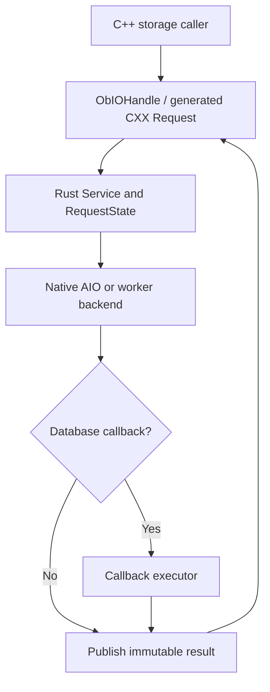
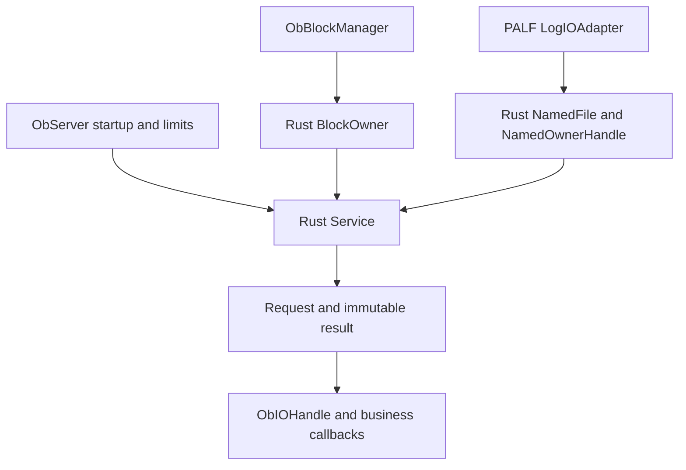

# Native I/O ownership

The Rust `storage-io::Service` owns request admission, submission, cancellation, deadlines, completion publication, and shutdown. C++ storage callers use `ObIOHandle`, which owns a generated CXX `Request`. The handle has no separate request state machine.

## Request flow

Storage callers submit through the data block owner or a PALF file. Rust captures the concrete file, admits the request, and allocates its aligned buffer. The service executes through native AIO when supported, or through the worker backend when required.

On physical completion, ordinary reads publish their owned buffer directly. Reads with a database callback enter the callback executor. The callback transforms bytes into a database object, such as a micro-block cache value. Rust owns the callback adapter and publishes its immutable output with the result.



`Pending`, `Delivering`, and `Ready` are request states. A separate physical operation can remain alive after a cancelled or timed-out request becomes ready. Its buffer and target stay owned until the backend retires it.

Cancellation can win while the request is pending. Once a callback enters `Delivering`, cancellation returns `NotPending`. A wait drains an executing callback before returning, even if its observation window expires. This protects existing callbacks that borrow caller context. A callback cannot block waiting for its own delivery or shutdown.

## Caller usage

For an ordinary asynchronous data read, call `ObBlockManager::submit_read` with a `MacroBlockId`, byte range, timeout, and business flags. Wait through `ObIOHandle::wait`, then borrow `get_buffer()` and `get_data_size()`. Keep the handle alive while using its bytes. Callers that need a separate destination copy after successful completion. The PALF synchronous read adapter performs that copy for its callers.

Writes supply input as a byte slice with native `RequestOptions`. Rust copies that input into an owned aligned buffer before the submission returns. The backend never retains the caller's source pointer.

Database callback callers transfer a `std::unique_ptr<storage_io::CallbackAdapter>` with the request. `adopt_callback` wraps an allocator-owned `ObIOCallback`. Typed result accessors borrow the callback's output. An output pointer is valid while the corresponding handle or result owner remains alive.

Cloning a handle shares the same request and result. Dropping the final handle cancels pending work or drains an executing callback. Physical retirement can finish later. A retained result does not require executor threads to stay alive after service shutdown.

## Physical block ownership

`storage-io::BlockFile` owns the file, published capacity, free blocks, pending releases and I/O region leases under one state mutex. The `capacity` module contains value types and arithmetic, not another stateful manager. Native Rust callers use the same operations as the generated CXX adapter:

```rust,ignore
let block = file.allocate_with_growth(
    GrowthPolicy {
        max_bytes: maximum,
        next_bytes: increment,
        usage_upper_percent: 90,
    },
    SpaceBudget { reserved_bytes: metadata_headroom },
)?;
```

A single-block allocation drains retired leases, uses a free block, or expands and synchronizes the file before publishing new blocks. Exhaustion returns a typed error; success always returns a block. The separate native `allocate_many` operation intentionally permits a short batch, including an empty batch. C++ production allocation does not adapt that batch interface into a single-block operation.

`FileSize::Bytes` and `FileSize::DiskPercentage` describe initial creation and explicit resizing. Existing files retain their on-disk size when opened. Manual resize is limited by available space and cannot shrink; the automatic-growth maximum does not restrict it. `extend_if_needed` implements pre-expansion from the existing C++ maintenance timer. Capacity observations and usage admission use the same Rust state and formulas. C++ no longer owns an expected-size retry protocol or a separate resize mutex.

Configuration values and the metadata headroom are passed per operation. Rust does not retain another mutable configuration copy. Headroom is a disk-space allowance, not allocated memory or a filesystem reservation. Actual filesystem operations can still fail after a capacity check; capacity becomes allocatable only after successful extension and synchronization. A failed extension may leave a longer physical file without publishing its extra blocks.

No reclamation thread is added. Releasing an unleased block makes it reusable immediately, including optional hole punching. If a released block has outstanding I/O leases, its final lease drop only queues the block. The next allocation or existing maintenance call drains that queue. With no subsequent call, reclamation remains pending; there is no periodic Rust worker promising prompt disk-space return.

Business liveness remains a distinct responsibility: C++ owns full `MacroBlockId` identity, handle references, recovery registration and the Tablet/SSTable/temp-file root traversal. Its mark/sweep protocol decides when to release a physical block. Rust leases then prevent reuse until actual I/O users retire. These two reference counts are not duplicate authoritative copies of the same state. Moving the business registry later requires switching allocation adoption, recovery and collection together; it must not introduce a parallel registry or collapse full identities to physical indices.

## Database integration

The database uses three C++ integration points. The old `src/share/io` directory and its manager, service, channel, request descriptor, and statistics wrappers are removed.

- `ObBlockManager` owns a generated `BlockOwner`. It prepares the data path during server initialization, then opens the block file after metadata reservations are available. It supplies configuration and metadata reservation inputs, maintains business block references, and converts `MacroBlockId` into a block operation. Rust owns physical capacity decisions and allocation. The three-word persisted block identifier is unchanged.
- `ObServerLogBlockMgr` owns a generated `NamedOwnerHandle` for the PALF file inventory. Each opened PALF file owns a generated `NamedFile`. `LogIOAdapter` provides the existing synchronous PALF contract using that file. Rust preserves synchronous write durability when opening writable log files, including the worker fallback.
- `share/io_request.h` provides common error conversion, request options, and `ObIOHandle`. The handle owns only a generated request. `ObIOFlag` contains business module, direction, and worker preference metadata. Cache-specific output access and callbacks remain in their storage modules.

`ObServer` owns the shared generated `ServiceHandle` and starts, configures, and stops the service. There is no `ObDeviceManager`, `ObIODevice`, or `ObLocalDevice`. CXX exposes concrete owners and logical byte ranges, without a generic device handle, descriptor registry, string options, or caller-visible alignment plan.

Each owner captures its file and execution endpoint under its session lock, then releases that lock before request admission can wait. Close prevents new captures and drains accepted operations outside the session lock. A captured request keeps the exact file alive through physical retirement. Reopening an owner cannot redirect an older request to its replacement file.

The common result adapter belongs in `share` because PALF and query do not depend on the storage implementation. It contains no service registry, queue, configuration snapshot, lifecycle state machine, or manual reference counter.

CXX generates the cross-language interface. `callback_adapter.h` is a typed C++ business adapter consumed by that interface. There is no handwritten C ABI, request cookie registry, or separate `request-runtime` crate.



Other C++ files still participate in I/O. `ObBlockManager` maintains database block identities, business references, recovery and reachability traversal; it delegates physical allocation and capacity management to Rust. `ObServerLogBlockMgr` integrates PALF inventory with server settings. PALF workers order log tasks, and storage callbacks decode blocks and populate caches. Their domain responsibilities remain separate from Rust request execution. Removing the generic device framework does not remove these callers or migrate their storage formats.


## C++ integration and consumers

Request construction is confined to `ob_block_manager.cpp`, `log_io_adapter.cpp`, and
`share/io_request.cpp`. The following command checks that boundary.

```sh
rg -l 'make_request_options\(|accept_io_request\(|submit_block\(|submit_named\(' src -g '*.cpp' -g '*.h'
```

The remaining consumers have database responsibilities. A file family below includes its
existing `.h` and `.cpp` files where both exist.

| Location and file families | Responsibility |
| --- | --- |
| `storage/blocksstable/ob_block_manager`, `logservice/palf/log_io_adapter`, `share/io_request` | Data and PALF submission, common results and errors. |
| `observer/ob_server`, `observer/omt/ob_server_runtime_controller` | Service startup, configuration, shutdown, and passing the log owner to the runtime. |
| `logservice/ob_server_log_block_mgr`, `logservice/ob_log_service`, `logservice/palf/palf_env`, `palf_env_impl`, `log_block_handler` | PALF inventory capacity and opened-file lifetime through existing log components. |
| `storage/blocksstable/ob_object_manager`, `ob_storage_object_handle`, `ob_storage_object_rw_info`, `ob_macro_block_handle` | Storage object identity, block references, and access to completed results. |
| `storage/blocksstable/ob_micro_block_cache`, `storage/access/ob_micro_block_handle_mgr`, `storage/meta_mem/ob_storage_meta_cache` | Decode micro-blocks and metadata and populate database caches. |
| `storage/tmp_file/ob_tmp_file_cache`, `ob_tmp_file_io_info`, `data_plane/api/data_plane/tmp_file/ob_tmp_file` | Temporary-page callbacks and result ownership. |
| `storage/blockstore/ob_object_reader_writer`, `ob_linked_macro_block_writer`, `storage/blocksstable/ob_macro_block_writer` | Object and linked-block read/write algorithms using domain submission. |
| `storage/compaction/ob_index_block_micro_iterator`, `storage/ob_parallel_external_sort`, `storage/tx_storage/ob_access_service` | Compaction, external sort, and the optimizer's existing I/O workload. |
| `observer/virtual_table/ob_all_virtual_io_status` | Read observed Rust I/O statistics. |

This inventory can be regenerated with the following reference search.

```sh
rg -l '#include "share/io_request.h"|storage_io::' src -g '*.cpp' -g '*.h' | sort
```

The service retains separate waits for memory admission and backend depth. Physical-operation
tracking keeps buffers alive after cancellation. Callback delivery runs outside the driver lock.
These states have different lifetime requirements, so removing the generic device framework
does not merge them into one queue.

## Memory and concurrency

`ObServer` normally owns one Rust service. A service is an I/O ownership domain, not a SQL tenant, connection, worker, or request. Data and PALF execution endpoints share its request and buffer limits.

| Resource | Limit and allocation | Release |
| --- | --- | --- |
| Admitted request records | The startup request limit, normally 10,000 records. Request objects are allocated as needed. Several bookkeeping collections reserve capacity for that ceiling. | Final request, result, and physical ownership release the record. Cancellation does not permit unlimited retained records. |
| Accounted I/O buffers | `io_buffer_limit`, or one fifth of configured server memory when zero. This is a ceiling, not an upfront payload allocation. | Physical retirement and final result ownership determine when bytes can be released. |
| File execution | A separate depth supplied when preparing each owner. It limits physical execution rather than allocating that many payload buffers. | Each operation retires its execution slot. |
| Callback delivery | Shares the admitted-record ceiling. Tokio blocking threads are created on demand, with a default ceiling of 16; idle threads exit after 10 seconds. | Shutdown drains accepted tasks, closes admission, and joins workers. |
| Progress and backend resources | Progress thread, backend queues, native AIO contexts, worker threads, and statistics lanes. Sizes depend on prepared owners and configuration. | Owner retirement and service shutdown. |

Blocking file operations and callback delivery use separate Tokio runtimes with only the
`rt` feature and the current-thread scheduler. They submit synchronous closures with
`spawn_blocking`; no async scheduler threads or dedicated thread reaper are started.
Each file endpoint has its own blocking pool (`file-io-worker`), and the service owns
one callback pool (`io-callback`). The queues remain bounded by existing backend depth
and admitted-request limits. Pool threads exit after 10 seconds idle. Native AIO
completion threads (`file-io-aio`) and the service progress thread (`io-progress`) remain.

`disk_io_thread_count`, `sync_io_thread_count`, and `_io_callback_thread_count` take effect
on restart. Their worker values are ceilings, not eagerly allocated thread counts.
Runtime shutdown drains blocking tasks; dropping a file backend preserves accepted
operations until physical completion. The existing release `panic=abort` policy also
applies if the operating system cannot create a required Tokio worker. Reaching the
configured thread ceiling simply queues work.

The service does not retain an idle buffer cache. Each aligned allocation is freed when its final request, result, or physical operation owner releases it. Callback-produced database objects use their existing database allocators and are additional to that aligned-buffer accounting. Thread stacks, queue metadata, allocator overhead, and kernel AIO resources are also additional.

Resource updates are serialized by the existing driver lock. They do not use a separate configuration generation or stale-write protocol. A lower limit can temporarily be below already accepted usage. Rust reports this debt and blocks new admission until existing owners release resources. It does not invalidate live buffers to force the new limit immediately.

Active disk diagnosis, probe buffers, probe partitions, and unused QoS group policies have been removed. The I/O virtual table exposes observed rates, size, and total completion latency. It does not display unmeasured stage timings. The empty calibration and benchmark virtual tables are removed. Writable startup retires their persisted catalog entries through the normal DDL transaction before opening the listener.

## Verification boundary

Rust tests cover request ownership and deterministic callback shutdown interleavings. Product builds and actual database reads, writes, flushes, and restart reads validate integration. The existing I/O performance driver is retained for frozen historical trees that expose the old device API. Its compile command rejects the current typed-owner tree. It does not justify retaining obsolete production interfaces. C++ lifecycle unit fixtures are not part of this migration's validation.

A prior branch's performance result does not establish this implementation's performance. Measurements must identify the frozen libraries, common driver source, successful operation counts, data checks, workload, and CPU time per GiB.

See [migration validation](native-io-validation.md) for the earlier measured comparison. Those frozen performance results predate the removal of the C++ management layer.

The earlier three-integration-point migration is recorded in [integration validation](native-io-integration-validation.md). That record predates removal of the generic device framework.

The typed-owner change is recorded in [owner validation](native-io-owner-validation.md).

## Tokio worker validation (2026-11-14)

The adapted product built successfully. The Rust CXX-enabled suites passed 134
file-io tests and 171 storage-io tests; one pre-existing external database fixture
was not run. Coverage includes dropping a backend with queued operations, callback
reentry, and shutdown racing with completion publication.

An isolated Linux instance wrote 2,048 rows (4 MiB of payload), flushed its tablet,
and verified the same count, ID sum, and payload length after an orderly restart.
Its settled I/O thread sample was two `file-io-aio`, one `io-progress`, one
`file-io-worker`, and zero `io-callback`. A separate cold-read observation showed
10 callback threads initially, two at 20 seconds, and zero at 30 seconds. Startup
background work can extend the time until the pool becomes entirely idle.

A direct production-backend probe submitted 100 operations with a four-thread cap
twice. Both rounds reached four workers and returned to zero after idle expiry.
These checks establish lifecycle behavior, not throughput or latency equivalence.
The existing instance on port 2991 was not restarted or upgraded.

Validated binary SHA-256: `bacd84a1b19774321820c0ff6ecaab9196f16ce685b0ced50f513448cf76c913`.

## Temporary-file caller structure

SQL spill uses one concrete C++ `ObTmpFileManager`, `ObSharedNothingTmpFile`, and
`ObSNTmpFileHandle`. The old abstract and SN manager layers and abstract file/handle
layers are removed. Cache, page-buffer, flush and eviction components retain their
database responsibilities and submit physical operations through the data-block
owner. See [C++ cleanup validation](native-io-cpp-cleanup-validation.md).
